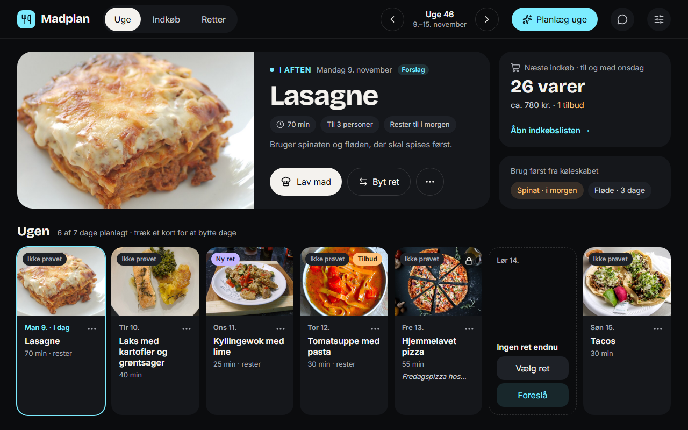
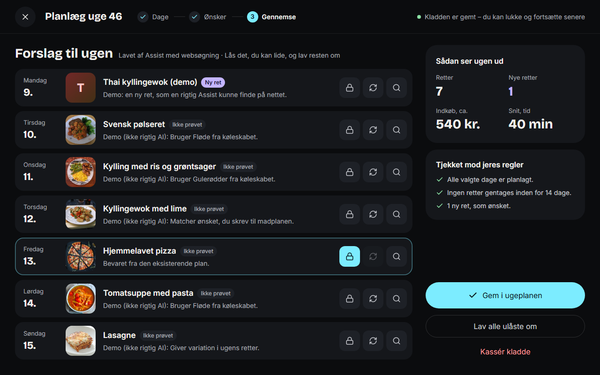
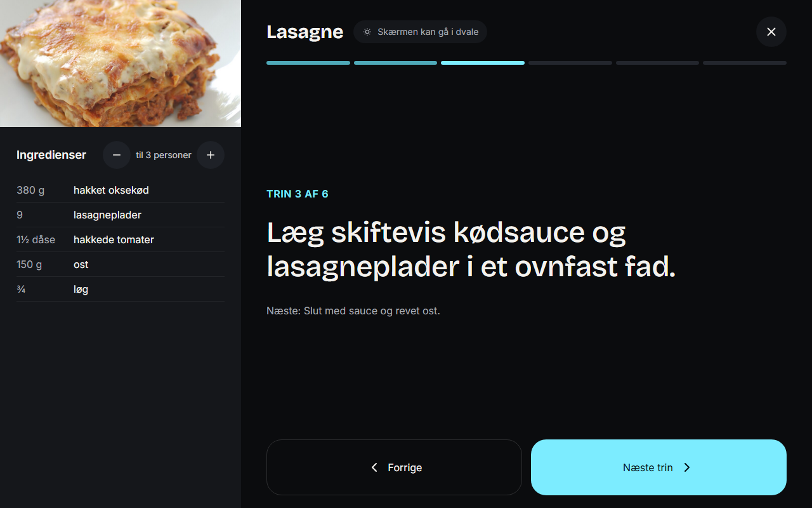
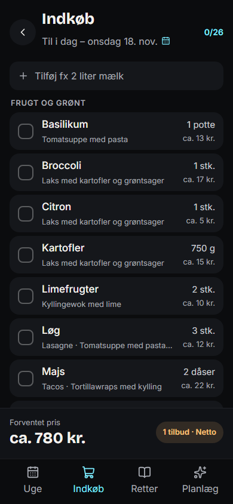

# Madplan

**Dansk:** Madplan er familiens madplan som app til Home Assistant: aftensmad for ugen, automatisk indkøbsliste, køleskab og basisvarer, kogetilstand med timere og en Assist-samtale. Brugerdokumentation (dansk) ligger i [madplan/DOCS.md](madplan/DOCS.md).

**English:** Madplan is a family meal planner packaged as a Home Assistant app (add-on, Ingress panel). The UI is Danish. Developer documentation is in English below.

| Uge (tablet) | Planlæg: gennemgang |
| --- | --- |
|  |  |

| Kogetilstand | Indkøb (telefon) |
| --- | --- |
|  |  |

## Install

In Home Assistant: **Settings -> Apps -> App store -> menu (three dots) -> Repositories**, add `https://github.com/clausjuul/ha-madplan`, then install **Madplan**, start it and open it from the sidebar. Options (`openai_api_key`, `prej_api_key`) are optional; see [madplan/DOCS.md](madplan/DOCS.md).

Supported architectures: `amd64`, `aarch64`. Images are published to GHCR (`ghcr.io/clausjuul/ha-madplan-{arch}`) when a `v*` tag is pushed; the tag must equal `version` in `madplan/config.yaml`. After the first release, make the GHCR packages public.

Before the repository is public you can build locally: `npm run build -w web && node scripts/bundle-local.ts`, then copy `dist-local/madplan/` to `/addons/madplan` on the Home Assistant host and install it as a local app.

## Development

Requires Node 24 (the server runs TypeScript directly through Node's type stripping, with `node:sqlite`).

```bash
npm install
npm run typecheck                 # tsc in all workspaces
npm test                          # vitest in all workspaces

npm run dev -w web                # web app with an in-memory FAKE API (default), http://localhost:5174
npm run dev:server -w web         # web app proxying /api to a real server on :8099
npm run dev:server                # real server in watch mode (./dev.sqlite, no ingress check)

npx playwright install chromium   # once
npx playwright test               # (cd web) fake-mode e2e incl. axe accessibility checks; E2E_PORT=5195 if 5174 is taken
npm run e2e:integration -w web    # e2e against the real server with a temp database
node scripts/render-assets.ts     # regenerates madplan/icon.png and logo.png from scripts/assets/
npm run build -w web && node scripts/bundle-local.ts   # self-contained local app in dist-local/madplan/
```

Fake mode is only used by the dev server (and the default Playwright run). Production builds always talk to the real API.

### Versioning

One version, kept equal by `server/test/version.test.ts`: `madplan/config.yaml`, root/domain/server/web `package.json`. The server reports it from `server/package.json` (`GET api/health`); the web app shows what the server reports in Settings. To release: bump all five, update `madplan/CHANGELOG.md`, commit, tag `vX.Y.Z`, push the tag.

## Architecture

- `domain/` - pure TypeScript (no I/O): types, planning and shopping rules, portions, pricing, review of plans, the bundled dish and inspiration catalogue, the v1 migration. The HTTP contract between server and web is `domain/src/api.ts`.
- `server/` - Hono API on `node:sqlite`. One `Repo` owns the connection and a single write path (one transaction per mutation, revision bump, change event after commit). Migrations are append-only in `src/db.ts`. Live updates reach clients over Server-Sent Events (`api/events`). It publishes the Home Assistant sensors `sensor.madplan_i_aften` and `sensor.madplan_indkob` through the Supervisor proxy, takes a daily backup (7 kept) and only serves requests coming through Ingress. OpenAI is behind a small client interface (`src/ai/openai.ts`) so tests use a fake; prompts keep our rules in the system `instructions` and untrusted data as fenced blocks in the user `input`. Assist proposals are stored in SQLite until they expire.
- `web/` - React 19, Vite, Tailwind v4, TanStack Query. Routes except the week view are lazy-loaded. `base: "./"` so it works under the Ingress path prefix. A fake in-memory API client (`src/api/fake-*.ts`) backs development and e2e tests.
- `madplan/` - the Home Assistant app folder: `config.yaml`, `DOCS.md`, `CHANGELOG.md`, icon/logo, translations. The root `Dockerfile` builds the multi-arch image; `.github/workflows/build.yaml` verifies and publishes it.
- `docs/design/` - the design mockups the UI was built from.

## License

MIT, see [LICENSE](LICENSE). Copyright (c) 2026 clausjuul.

The bundled dish and inspiration photos are not covered by the MIT license: they keep their own licences, listed in [web/public/images/dishes/README.md](web/public/images/dishes/README.md) and [web/public/images/inspiration/README.md](web/public/images/inspiration/README.md).
